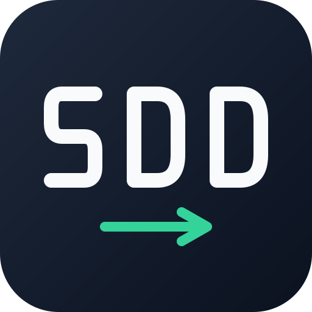

<p align="center">
  
</p>

<h1 align="center">Awesome SDD</h1>

<p align="center">
  <strong>Talk through the idea. Build it in steps. Check what ships.</strong><br>
  A plugin for Claude Code and Codex, with plain English questions and decisions saved in your repo.
</p>

<p align="center">
  <a href="#install">Install</a> ·
  <a href="#start-here">Start here</a> ·
  <a href="#how-it-works">How it works</a> ·
  <a href="#make-it-yours">Settings</a> ·
  <a href="#skill-reference">All skills</a>
</p>

---

Awesome SDD helps you turn an idea into a specification, a plan, tested code, and a reviewed change.
You decide what matters. SDD keeps the documents and tasks up to date as you go.
Expand the sections below for setup details, settings and the full workflow—all on this page.

**One choice at a time.** Questions describe the behavior you're deciding, with technical detail
when it helps. You can answer briefly, change your mind, or pick things up later.

> **SDD:** Should people stay signed in after closing the browser?\
> **You:** Yes.\
> **SDD:** How long should they stay signed in?\
> **You:** Thirty days.\
> **SDD:** Got it. I'll record that and cover it in the tests.

## Install

Choose your app. Use one installation method to avoid duplicate skills.

### Claude Code

Run inside Claude Code:

```text
/plugin marketplace add blackPeanut/awesome-sdd
/plugin install awesome-sdd@awesome-sdd
```

Then ask: **“Use SDD to survey this repository.”**

### Codex desktop or CLI

Run in a terminal with `codex` available:

```sh
codex plugin marketplace add blackPeanut/awesome-sdd
codex plugin add awesome-sdd@awesome-sdd
```

Restart the desktop app, open **Plugins**, and find **Awesome SDD**. Start a chat in your
project, select SDD, and ask: **“Use SDD to survey this repository.”**

This installs the native plugin for both desktop and CLI. SDD itself needs no separate service
or API key; it uses your host's model access.

<details>
<summary><strong>Installation options, updates and removal</strong></summary>

### Choose one installation

| Method | Best for | Where it appears |
|---|---|---|
| Claude Code native plugin | Claude Code sessions | `/awesome-sdd:` commands |
| Codex native plugin | Codex desktop and CLI | A plugin card and skills such as `$specify` |
| Copied Codex skills | Skills scoped to a project, or environments where native plugins aren't available | Skills such as `$sdd-specify`; no plugin card |

The marketplace and plugin are both named `awesome-sdd`. Existing `.claude/sdd.local.md`
settings and copied `$sdd-*` skills keep their names for compatibility. If an upstream SDD copy is
installed, remove it separately before installing this version to avoid duplicate skills.

### Claude Code

Re-run the install command inside Claude Code, then reload plugins:

```text
/plugin install awesome-sdd@awesome-sdd
/reload-plugins
```

Use Claude Code's plugin manager to remove the plugin.

### Codex desktop and CLI

Update the marketplace and install its current SDD version:

```sh
codex plugin marketplace upgrade awesome-sdd
codex plugin add awesome-sdd@awesome-sdd
```

Restart the desktop app after updating. To remove SDD:

```sh
codex plugin remove awesome-sdd@awesome-sdd
```

Removal leaves the marketplace registered.

</details>

<details>
<summary><strong>Install from a checkout or use project-only skills</strong></summary>

### Native plugin from this checkout

For the native Codex plugin:

```sh
bash install.sh codex-app
```

This registers and installs the **published** marketplace version. It is user-wide and does not
copy this working tree or write project settings. The helper needs `codex` on PATH; otherwise
set `SDD_CODEX_BIN` to the full path of your Codex executable, including the app's bundled one.

`--prefix`, `--src` and non-main `--ref` values belong to copied-skill installs, not `codex-app`.

### Copied project skills

Run from the project where you want the skills:

```sh
curl -fsSL https://raw.githubusercontent.com/blackPeanut/awesome-sdd/main/install.sh | bash -s -- codex
```

This writes `.agents/skills/` and `.codex/agents/`. Restart Codex and use `$sdd-survey`,
`$sdd-specify`, and the other prefixed names. These skills work in desktop and CLI, but do not
create a card in the Plugins directory. Python 3 is required to generate the Codex agent files.

From a local checkout, choose a different scope or test your edits:

```sh
bash install.sh codex --prefix /path/to/project
bash install.sh codex --global
bash install.sh codex --src . --prefix /path/to/test-project
```

Re-run the same install command to update. Add `--ref <release-tag>` to download a particular
release. For removal, use the same scope as the original install:

```sh
bash install.sh codex --prefix /path/to/project --uninstall
```

Use `--global --uninstall` for a global copy. Project settings are retained. If switching to
the native plugin, remove the copied installation first.

Windows users can run the Bash helper through Git Bash or WSL in the environment used for Codex.

</details>

<details>
<summary><strong>Troubleshooting and interrupted upgrades</strong></summary>

| Problem | Check this |
|---|---|
| No SDD card in Codex | Run `codex plugin list --json`. Check that `awesome-sdd@awesome-sdd` is installed and enabled, then restart the app. Copied skills don't create a card. |
| Installed in the terminal, missing in the app | Check that both use the same local account and Codex configuration. A remote host has its own installation. |
| Duplicate skills | Keep one Codex installation method. Remove an older upstream plugin or copied installation separately. |
| `codex` isn't found | Put the executable on PATH, or set `SDD_CODEX_BIN` when using the helper. |
| Looking in a public plugin directory | This repo provides its own Git-hosted marketplace; registration does not create a universal public listing. |
| A skill reports missing Python or PyYAML | Settings and implementation-recovery helpers need Python 3.10+ and PyYAML in the environment running them. |


### If an upgrade is interrupted


The copied-skill installer downloads, validates and stages the replacement before swapping it
in. Ordinary failures and catchable termination signals restore the previous copy. Unrelated
agents and existing settings are preserved.

Backups live under `.agents/.sdd-installer/` at the installation prefix, outside skill discovery.
The installer prints the transaction directory. Keep its `previous-skills` and `previous-agents`
while you may need to recover; never remove a transaction referenced by `pending`.

If the process was killed without cleanup:

1. Read `lock/pid` in that state directory.
2. Confirm that the installer process is no longer running.
3. Remove only the stale `lock` directory, then rerun the same installer command.

The next run restores the pending swap before attempting a new upgrade. Native plugin updates
are managed by the host instead.

</details>

## Start here

Pick the request closest to where you are. You don't need to learn every command first.

| You want to… | Say this |
|---|---|
| Understand an existing codebase | “Use SDD to survey this repository.” |
| Talk through a rough idea | “Use SDD to interview me about saved searches.” |
| Plan a feature you already understand | “Use SDD specify for saved-searches. People should be able to save and reuse a search.” |
| Break a larger idea into steps | “Use SDD roadmap with the idea brief we wrote.” |
| Pick up an existing feature | “Use SDD status for saved-searches. Where are we?” |
| Fix a bug | “Use SDD fix. Saving the same search twice creates a duplicate.” |

Give each feature a short name such as `saved-searches` and reuse it throughout the workflow.
Its files live in `docs/features/saved-searches/`.

At the end of a stage, SDD tells you what changed and what to do next:

> Saved searches now have a spec, including duplicate handling.\
> Your decisions are saved in `spec.md`. Next, we'll check the open questions.

Follow that next step. SDD checks the files a stage needs before proceeding, and adapts handoffs
to your app. When fresh context is needed, Codex desktop uses a new chat in the same project;
Claude Code uses `/clear`.

> [!TIP]
> Want to keep commits in your hands? Before starting, ask **“Use SDD config to turn off automatic
> commits.”** By default, SDD commits completed documents and verified implementation tasks.

## How it works


| Step | What happens | What you keep |
|---|---|---|
| **Decide** | Work through the behavior, constraints and open questions. | A specification with clear examples of success. |
| **Design** | Work out how the feature fits your codebase, data and interfaces. | A design, relevant decisions, and UI flows when needed. |
| **Build** | Split the work, write tests, implement and verify each task. | Code, tests and a record of progress. |
| **Review** | Check the whole change against what you agreed. | Findings, resolutions and the version that was reviewed. |
| **Prepare to ship** | Exercise the feature, write the changelog and prepare the PR. | Verification notes and a PR draft or authorized PR. |

Small changes use less detail. Optional steps can be skipped when they don't apply; UI work adds
user flows and screen states. SDD explains the next step instead of asking you to run a giant
checklist. Pushing or opening a PR needs authorization; merging stays your call.

<details>
<summary><strong>See the full stage order</strong></summary>

For a new codebase, `survey` plans the foundation and `scaffold` builds the starting skeleton.
For UI work, `design-system` establishes the shared components and styles before the first feature.

The full per-feature path is:

```text
specify → clarify → ux-flows → design → sequences
    → data-model → api → screens → tasks → plan-tests
    → implement → review → ship
```

The route determines how optional steps are handled:

| Route | How it behaves |
|---|---|
| `quick` | Skips optional steps when their conditions show they aren't needed. |
| `standard` | Offers those skips for you to choose. |
| `full` | Walks every stage. |

The default comes from feature size: XS/S → quick, M → standard, L/XL → full.
You can change it with `classify-size`. The route affects the suggested next step; you can still
ask for a skipped stage directly.

| Optional stage | When it may be skipped |
|---|---|
| `clarify` | There are no open questions or flagged ambiguities. |
| `ux-flows` | The feature has no human-facing UI. |
| `sequences` | A simple interaction has no multi-step flow to explain. |
| `data-model` | There is no schema change. |
| `api` | There is no interface or contract change. |
| `screens` | The design declares no UI surface. |
| `plan-tests` | The plan can live in the spec; a separate step may be skipped when every task already names its test. |

`specify`, `design`, `tasks`, `implement`, `review` and `ship` remain part of every feature route.
A small feature with a database change still needs its data-model work.

</details>

## Keep working without losing your place

| When… | SDD's workflow |
|---|---|
| **You return later** | `status` reads saved work and evidence, then gives you what's finished, blocked and next. It doesn't start work or edit files. |
| **You change your mind** | Updates the affected documents, tasks and tests while keeping unrelated decisions and work. |
| **A task gets stuck** | Preserves earlier edits and staging. Undo is limited to changes it can identify as its own; uncertain overlaps are left in place. |
| **A run is interrupted** | Checks saved test evidence and Git before treating a task as complete. With commits off, verified work can remain uncommitted. |
| **Files change after review** | Rechecks the affected parts before calling the change ready to ship. |
| **Settings are malformed** | Stops before changing the project. It doesn't silently replace your preferences with defaults. |

<details>
<summary><strong>What the checks cover</strong></summary>

Local automated tests cover installation, failed upgrades, malformed settings, implementation
recovery and review snapshots. Review checks include changed code, changed requirements, new
files and reviewed work that hasn't been committed.

Live Claude/Codex evaluations use disposable projects to exercise conversations and workflow
behavior. They consume model usage. Headless text tests don't prove desktop question widgets or
all interactive behavior; those need separate human checks.

</details>

## Make it yours

Ask **“Use SDD config”**, or name the preference directly:

> “Ask me about each meaningful choice, but keep the questions short.”\
> “Turn off automatic commits.”\
> “Run implementation one task at a time.”

| Preference | Choices |
|---|---|
| **Discussion depth** | `easy`: more routine choices handled for you. `medium`: discuss meaningful choices. `hard`: explore tradeoffs and edge cases more deeply. Questions stay plain at every level. |
| **Commits** | Per task, per phase, or off. Turning them off also stops document commits. |
| **Execution** | Sequential work, or parallel work when the host, permissions and task dependencies support it. |
| **Checks** | Test, integration, lint and static-analysis settings, with command overrides when detection needs help. |

Codex uses its current session model. Claude model preferences such as `judgment_model` apply
only on hosts that support them. Missing delegation or workflow tools fall back to inline or
sequential work, with the limitation stated. An inline self-check is not an independent review.

<details>
<summary><strong>Discussion depth: how much SDD asks you</strong></summary>

| Level | What to expect |
|---|---|
| `easy` | Handles routine, reversible choices using the project conventions. States assumptions so you can correct them. Asks about consequential or unclear choices. |
| `medium` | Discusses each meaningful decision, one straightforward question at a time. |
| `hard` | Explores more tradeoffs and edge cases. Questions still stay short and separate. |

For `specify`, `clarify` and `design`, an explicit `--depth=` wins, then your preference in the
conversation, then the saved `interview_depth`. The default is `medium`. Changing the pace for
one run doesn't change the saved setting; ask `config` to save it.

For example, in Claude Code: `/awesome-sdd:specify saved-searches --depth=easy`.

The initial `interview` skill uses a question limit instead: easy up to 4, medium up to 10,
hard up to 15. You can extend the limit. It can stop earlier when there's enough information,
and it doesn't invent answers to finish within the limit.

Depth changes how much you discuss, not which requirements must be covered. Accepted answers
carry forward, so later stages shouldn't ask you to decide the same thing again.

</details>

<details>
<summary><strong>Agents and parallel work: what implement actually does</strong></summary>

| Mode | How the work happens |
|---|---|
| Sequential | One task at a time: failing test → implementation → checks. |
| Agent team | A lead coordinates a test author, implementer and reviewer. Independent work can happen alongside other work. |
| Automated workflow | Independent tasks run in parallel, then their changes are brought together and checked. |

The defaults are `team_mode: true`, `workflow_mode: auto` and a limit of three parallel agents.
Team mode takes priority when supported. Existing settings keep their saved value; this default
applies to new settings or a missing key. SDD follows your saved choice and announces
the selected mode; it doesn't need to ask again unless authorization or a decision is missing.

Parallel work needs independent tasks, separate Git working folders (`isolation: worktree`),
a limit above one, enough work to justify coordination, and a compatible host backend.
Tasks touching the same files are kept in order. The lead combines the changes and verifies them.

`max_parallel_agents: 1`, `isolation: inplace`, or `auto_commit: off` makes implementation
sequential. The current parallel recipes need commits so later tasks can start from earlier work.

**Current Codex limitation:** the team recipes expect `TeamCreate` or `Workflow` capabilities.
Ordinary subagents alone don't satisfy that requirement, so implementation falls back to
sequential work. A separate reviewer can still be used when delegation is available and allowed.
Turning `team_mode` on doesn't remove this limitation.

SDD respects the host's permissions and your existing authorization. A missing tool changes the
execution mode, not your saved preferences.

</details>

<details>
<summary><strong>Models, effort and differences between Claude and Codex</strong></summary>

| Setting or behavior | Claude Code | Codex |
|---|---|---|
| Model selection | Uses compatible saved role preferences and supported overrides. | Inherits the session model unless you explicitly authorize a supported override. |
| `judgment_model` | Preference for review and reasoning roles; default `opus`. Per-role choices take precedence. | Retained in settings but not translated into a Codex model. |
| `model_test_author`, `model_implementer`, `model_reviewer` | Defaults are `sonnet`, `sonnet`, `opus`. | Claude tier names aren't applied. |
| `effort_test_author`, `effort_implementer`, `effort_reviewer` | Defaults are `medium`, `medium`, `high`, where supported. | Uses the host's supported controls and authorization. |
| Fresh context | `/clear` in an interactive session. | A new chat in the same project in desktop, or `/new` in interactive CLI. |
| Questions | The available question tool. | The available question tool, or a plain text question when needed. |

On Claude, an unset judgment preference is a minimum preference, not a forced downgrade from a
stronger session model. If the comparison is unknown, SDD inherits rather than guessing.
If an allowed model or effort override is unavailable, it retries once with host inheritance
and tells you. Authentication and permission errors aren't treated as model availability errors.

A separate review requires an available, authorized reviewer. If only an inline self-check is
possible, SDD says so. A headless run stops at an unanswered decision instead of claiming you
approved it.

</details>

### The settings file

Settings live in `.claude/sdd.local.md` **for both Claude and Codex**. The name is shared for
compatibility. The file is per project, gitignored, and created when a writing workflow first
needs it. `config` changes only the preferences you agree to change.

<details>
<summary><strong>Show all defaults</strong></summary>

```yaml
interview_depth: medium    # easy | medium | hard — plugin-wide default for specify/clarify/design
artifact_language: en      # English only; legacy non-en values are treated as en
tdd: true                  # enforce red→green→refactor
team_mode: true            # true → agent team via TeamCreate
workflow_mode: auto        # auto → dynamic Workflow; off → never
max_parallel_agents: 3     # integer ≥1 — fan-out cap for team/workflow modes (1 = sequential)
isolation: worktree        # worktree | inplace (parallel>1 ⇒ forces worktree)
stop_on_red: true          # halt on a red that survives escalation, vs drop-and-continue
max_red_retries: 3         # integer ≥1 — RED→GREEN attempts before escalation
gate_lint: true            # true | false — include lint in the per-task gate
gate_vet: true             # true | false — include vet / static-analysis in the per-task gate
require_integration: auto  # auto | always | never (Docker-probed)
auto_commit: per_task      # per_task | per_phase | off — off also stops document-stage commits
branch_strategy: feature   # feature | current
cmd_test_unit: ""          # empty = autodetect (escape hatch)
cmd_test_integration: ""
cmd_lint: ""
cmd_vet: ""
model_test_author: sonnet  # per-role model; inherit = session model
model_implementer: sonnet
model_reviewer: opus
judgment_model: opus       # Claude-only preference; Codex inherits its session model
effort_test_author: medium # per-role effort; raised to high on escalation
effort_implementer: medium
effort_reviewer: high
```

Legacy non-English `artifact_language` values still produce English conversation and documents.
Existing unrelated content and exact source quotations are preserved.

The settings and implementation-recovery helpers require Python 3.10+ and PyYAML. The review
snapshot helper uses Python 3.10+ with no extra packages. A missing required dependency is reported
before the workflow proceeds.

Missing files or missing keys use these defaults. Invalid existing settings stop the workflow
before writes, commands with side effects, or commits. Unknown keys and your comments are
preserved. `config` changes values individually rather than replacing your whole file.

</details>

<details>
<summary><strong>What each setting controls</strong></summary>

### Conversation

| Setting | Meaning |
|---|---|
| `interview_depth` | `easy`, `medium` or `hard`; controls discussion depth as described above. |
| `artifact_language` | English only. Legacy values don't switch the conversation or new documents to another language. |

### Implementation and commits

| Setting | Meaning |
|---|---|
| `tdd` | `true` writes a failing test before implementation. `false` skips that step and reports it. |
| `team_mode` | Requests the agent-team recipe when supported and suitable. |
| `workflow_mode` | `auto` allows the automated parallel recipe when supported; `off` disables it. |
| `max_parallel_agents` | Maximum parallel agents; `1` means sequential. |
| `isolation` | `worktree` gives parallel agents separate Git working folders. `inplace` uses the current checkout and forces sequential work. |
| `auto_commit` | `per_task` commits verified tasks individually; `per_phase` groups tasks in a dependency layer; `off` leaves changes uncommitted. Document stages commit per document under either enabled mode. |
| `branch_strategy` | In `implement`, `feature` creates a feature branch when starting on the default branch; `current` keeps the current branch. Document stages use the current branch. |

### Checks and failures

| Setting | Meaning |
|---|---|
| `stop_on_red` | `true` stops after an unresolved failure. `false` blocks that task and its dependents, then continues independent work. |
| `max_red_retries` | Attempts to get the failing test passing before further escalation. |
| `gate_lint` | Includes lint when a lint command is available. |
| `gate_vet` | Includes static analysis or type checking when a command is available. |
| `require_integration` | `auto` runs integration tests when the current Docker probe succeeds; otherwise records them as skipped. `always` blocks if Docker is unavailable. `never` skips this tier. |

The current integration check uses Docker availability. A skipped check is never reported as a pass.

### Command overrides

| Setting | Overrides |
|---|---|
| `cmd_test_unit` | Unit-test command. |
| `cmd_test_integration` | Integration-test command. |
| `cmd_lint` | Lint command. |
| `cmd_vet` | Static-analysis or type-check command. |

An empty string means automatic detection from the repo's Makefile, package scripts and language
manifests. Set an override only when that detection doesn't find the right command.

### Models and effort

`model_test_author`, `model_implementer` and `model_reviewer` select role models where the host
supports them. `effort_test_author`, `effort_implementer` and `effort_reviewer` set the respective
reasoning effort. `judgment_model` supplies the Claude judgment preference. Their defaults and
host-specific behavior are in the expandable sections above.

</details>

## Skill reference

SDD includes **24 atomic skills**. Use their names in a request, or invoke them directly:

| Installation | Example |
|---|---|
| Claude Code plugin | `/awesome-sdd:specify saved-searches` |
| Codex native plugin | `$specify saved-searches` |
| Codex copied project skills | `$sdd-specify saved-searches` |

<details>
<summary><strong>Explore all 24 skills</strong></summary>

### Get oriented

| Skill | Use it to… |
|---|---|
| [interview](skills/interview/SKILL.md) | Explore an idea and decide whether it's ready to plan. |
| [survey](skills/survey/SKILL.md) | Map an existing repo, or plan the foundation of a new one. |
| [roadmap](skills/roadmap/SKILL.md) | Turn a source brief into ordered steps and dependencies. |
| [scaffold](skills/scaffold/SKILL.md) | Build the starting skeleton for a new project. |

### Shape the feature

| Skill | Use it to… |
|---|---|
| [specify](skills/specify/SKILL.md) | Agree on behavior and write the specification. |
| [clarify](skills/clarify/SKILL.md) | Resolve unclear or conflicting requirements. |
| [design-system](skills/design-system/SKILL.md) | Establish shared UI styles, components and design tools. |
| [ux-flows](skills/ux-flows/SKILL.md) | Map what people do and which screens they need. |
| [design](skills/design/SKILL.md) | Fit the feature into the system and record significant decisions. |
| [sequences](skills/sequences/SKILL.md) | Show how the parts interact while the feature runs. |
| [data-model](skills/data-model/SKILL.md) | Plan data changes and prepare migrations for implementation. |
| [api](skills/api/SKILL.md) | Define or update the interface contract. |
| [screens](skills/screens/SKILL.md) | Specify screen states and the components they reuse. |

### Build and check

| Skill | Use it to… |
|---|---|
| [tasks](skills/tasks/SKILL.md) | Split the design into small, testable tasks. |
| [plan-tests](skills/plan-tests/SKILL.md) | Connect requirements to tests. |
| [implement](skills/implement/SKILL.md) | Build tasks through the test → code → verify cycle. |
| [review](skills/review/SKILL.md) | Check the whole change and resolve findings. |
| [ship](skills/ship/SKILL.md) | Verify the feature and prepare its changelog and PR. |

### Use anytime

| Skill | Use it to… |
|---|---|
| [status](skills/status/SKILL.md) | Get a read-only recap and the next step. |
| [config](skills/config/SKILL.md) | Change project preferences. |
| [classify-size](skills/classify-size/SKILL.md) | Reassess feature size and route. |
| [glossary](skills/glossary/SKILL.md) | Keep domain terms consistent. |
| [decide-adr](skills/decide-adr/SKILL.md) | Record an architectural decision separately. |
| [fix](skills/fix/SKILL.md) | Reproduce and fix a bug, even without existing specs. |

</details>

## Where things are saved

The conversation stays brief. The details stay in your project:

```text
docs/
├── idea-brief.md          # The idea and what you decided
├── architecture-map.md    # How the existing system works
├── roadmap.md            # The larger plan, when needed
├── design-system.md      # Shared UI conventions, when needed
└── features/
    └── saved-searches/
        ├── spec.md       # What the feature should do
        ├── sad.md        # How it fits the system
        ├── adr/          # Architectural decision records
        ├── contracts/    # Interface definitions
        ├── tasks.json    # Tasks and dependencies
        ├── tasks/        # Task details, progress and test evidence
        └── _review/      # Review reports and input snapshots
```

Some files appear only when the feature needs them. UI flows, screen plans, data models and
migration files are added by their respective stages.

## Help and contributing

- **Can't find the plugin?** Open “Troubleshooting and interrupted upgrades” under [Install](#install).
- **A stage won't proceed?** Read the missing prerequisite it names and keep the feature name
  consistent. `status` can explain what is ready and what still needs work.
- **Want the implementation details?** Browse [skills](skills/), [shared rules](skills/_shared/)
  and [agent roles](agents/).
- **Changing the plugin?** Start with `python3 scripts/validate_plugin.py` and the relevant
  [tests](scripts/). For live Claude/Codex evaluations, see the [evaluation guide](evals/README.md);
  those runs use model access and may incur usage costs.
- **Found a problem?** [Open an issue](https://github.com/blackPeanut/awesome-sdd/issues).

## Credits and license

Maintained by [blackPeanut](https://github.com/blackPeanut).
Available under the [MIT license](LICENSE), with the original copyright notice preserved.

This is a Git-hosted community plugin, not an official OpenAI or Anthropic marketplace listing.
